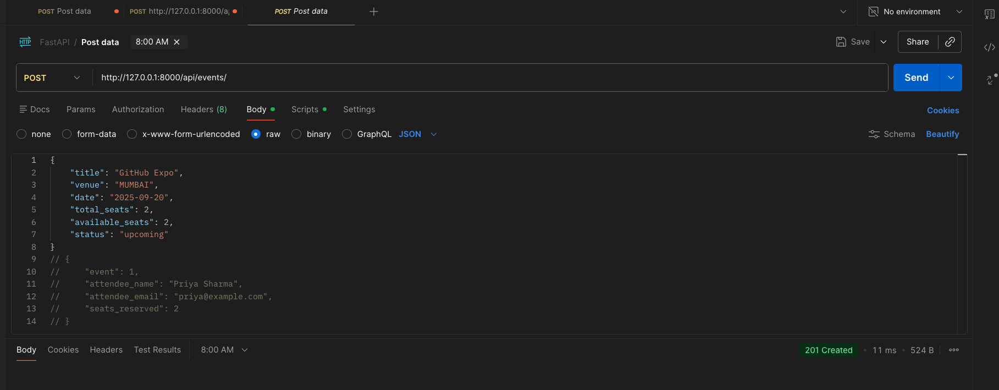
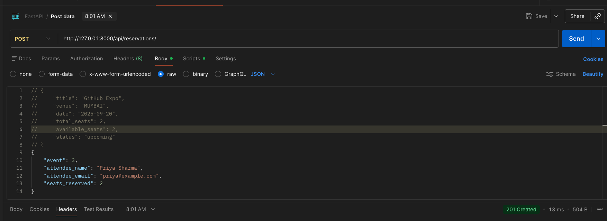
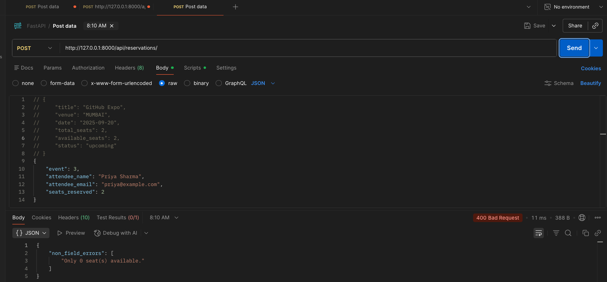
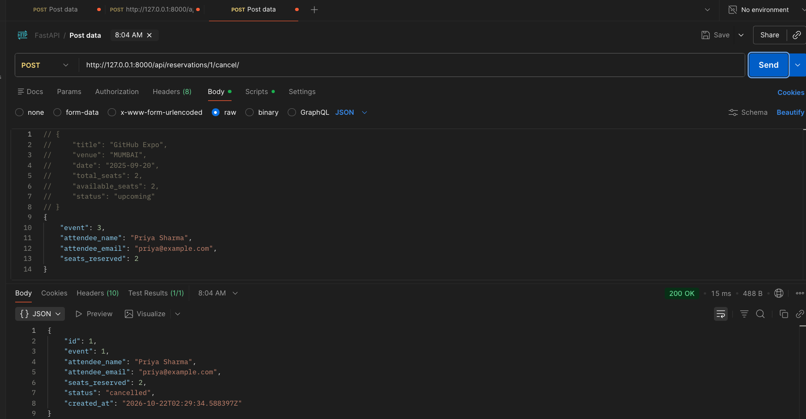

# EventHub

Backend API for a simplified event ticketing platform — browse events, reserve seats, cancel reservations.

## Run it

```bash
cd eventhub
python3 -m venv ../.venv && source ../.venv/bin/activate   # or use your existing venv
pip install -r requirements.txt
python manage.py migrate
python manage.py runserver
```

API is served at `http://127.0.0.1:8000/api/`.

## Endpoints

| Method | Path | Description |
|---|---|---|
| GET | `/api/events/` | List all events (filter with `?status=` and `?venue=`) |
| POST | `/api/events/` | Create an event |
| GET | `/api/events/{id}/` | Get a single event |
| PUT | `/api/events/{id}/` | Update an event |
| DELETE | `/api/events/{id}/` | Delete an event |
| GET | `/api/reservations/` | List all reservations (filter with `?event_id=`) |
| POST | `/api/reservations/` | Reserve seats for an event (deducts `available_seats`, 400 if not enough seats left or event isn't upcoming/ongoing) |
| GET | `/api/reservations/{id}/` | Get a single reservation |
| POST | `/api/reservations/{id}/cancel/` | Cancel a reservation and restore seats to the event |

Every request is logged by `RequestLoggingMiddleware` (method, path, status, duration).

## Design decision

Seat deduction happens inside `ReservationSerializer.create()` rather than in the view, so creating a reservation and decrementing `Event.available_seats` always happen together as one unit — there's no path where a reservation is saved without the seat count updating (or vice versa). This is sufficient for a single-process, low-concurrency setup; a production version handling simultaneous bookings would wrap this in `transaction.atomic()` with `select_for_update()` to prevent two users claiming the same last seat.

## Postman verification

**Create event — 201 Created**


**Reserve seats — 201 Created**


**Overbooking rejected — 400 Bad Request**


**Cancel reservation — 200 OK**

